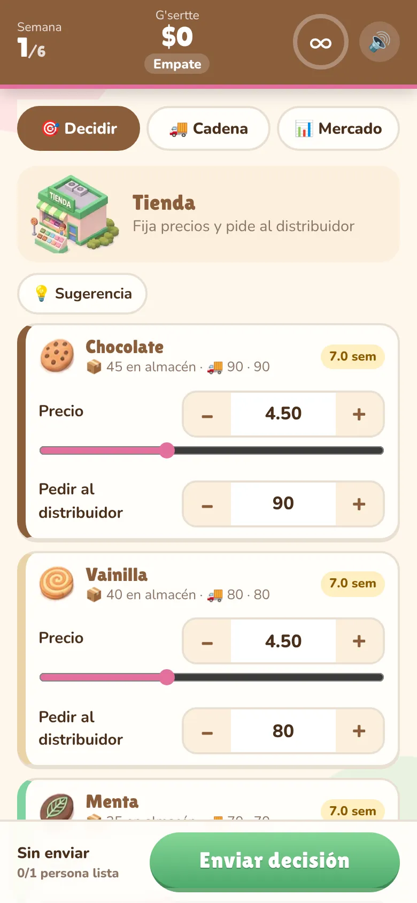
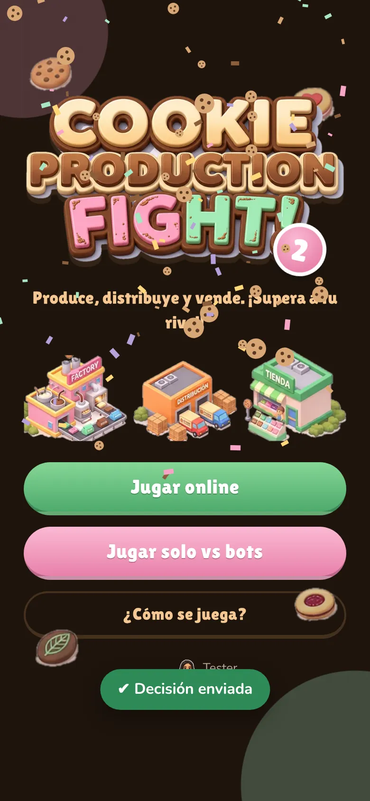

<p align="center"></p>

<p align="center"><b>Produce, distribuye y vende. ¡Supera a tu rival!</b><br>
Juego multijugador de cadena de suministro para celulares: 2 equipos × (Fábrica → Distribuidor → Tienda).</p>

<p align="center">



</p>

**Jugar:** https://ramirezramosrenzo3.github.io/Cookie-Production-Fight-2/ (requiere activar GitHub Pages, ver [`docs/DESPLIEGUE.md`](docs/DESPLIEGUE.md)).

## Cómo se juega

Cada equipo maneja una cadena de galletas. La **Fábrica** elige calidad y producción, el **Distribuidor** hace pedidos y puja por influencers, la **Tienda** fija precios y pide mercadería. Todo tarda 2 semanas en llegar, el mercado se reparte entre los dos equipos y hay eventos (Navidad, huelgas, ratas…) y sabotajes (Incendio, Fake News, GTA). Gana quien tenga más dinero al final.

- **Jugar solo:** tú contra 5 bots, sin internet.
- **Online:** hasta 6 personas; los lugares vacíos los ocupan bots.
- **Modo presentador:** `?tv=CODIGO` para proyectar en clase.

Reglas completas en [`docs/REGLAS.md`](docs/REGLAS.md).

## Novedades frente a la v1

| | v1 | v2 |
|---|---|---|
| Carga inicial | 4,3 MB de imágenes | ~0,6 MB (WebP) + 34 KB de JS |
| Red por celular | ~7 solicitudes/s, historial completo | 1 solicitud cada 1,5 s, incremental |
| Bots | Un celular envía por ellos (suplantables) | Calculados en el motor de cada dispositivo |
| Identidad | UUID en localStorage como parámetro | Sesión anónima de Supabase Auth |
| Interfaz | Tablas de inputs | Tarjetas por sabor, −/+, cobertura, pestañas |
| Diversión | — | Sonido, vibración, confeti, premios, mensajes al equipo |
| Final | Total de dinero | Informe: efecto látigo, KPIs, premios, consejos |
| Calidad | 122 pruebas del motor | Paridad con la v1 + pruebas de reglas, SQL y navegador, CI |

El análisis completo está en [`docs/ANALISIS.md`](docs/ANALISIS.md).

## Desarrollo

```bash
npm install
npm run dev          # http://localhost:5173 (modo solo funciona sin configurar nada)
npm test             # motor, paridad con la v1, analítica
npm run typecheck
npm run build
```

Para el modo online sigue [`docs/DESPLIEGUE.md`](docs/DESPLIEGUE.md).

## Estructura

```
src/engine/   motor determinista (reglas, simulación, bots, analítica)
src/net/      transportes: local (vs bots) y Supabase
src/ui/       pantallas y componentes (Preact)
src/fx/       sonido, vibración y confeti
supabase/     migración SQL y pruebas
legacy/       motor v1 para la prueba de paridad
docs/         análisis, arquitectura, reglas, despliegue, roadmap
```

Detalles en [`docs/ARQUITECTURA.md`](docs/ARQUITECTURA.md) · Próximos pasos en [`docs/ROADMAP.md`](docs/ROADMAP.md).

---

© Cookie Production Fight!. Todos los derechos reservados sobre el nombre, el arte y los personajes.
